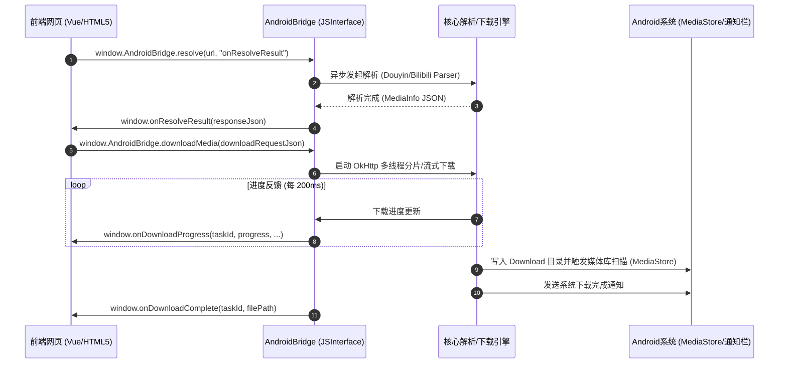

# Web-Native Bridge Contract Specification (Web与原生桥接契约规范)

> **版本 (Version):** 1.0.0  
> **包名 (Namespace):** `com.yaoxiovo.downloader`  
> **注入对象 (JS Object):** `window.AndroidBridge`  
> **目标运行环境:** Android WebView (Android 7.0+ / API 24 ~ API 34)

---

## 1. 架构拓扑 (Architecture Topology)



---

## 2. 核心方法契约 (Method Signatures)

所有注入方法均位于全局 `window.AndroidBridge` 对象上。前端在调用前可通过 `if (window.AndroidBridge) { ... }` 判断是否运行于 Android 客户端内。

### 2.1 客户端环境与权限 (Environment & Permissions)

#### `getVersion()`
* **类型:** 同步调用
* **入参:** 无
* **返回值:** `string` (如 `"1.0.0"`)
* **说明:** 获取当前原生客户端版本号。

#### `hasStoragePermission()`
* **类型:** 同步调用
* **入参:** 无
* **返回值:** `boolean` (`true` 表示已授权，`false` 表示未授权)
* **说明:** 检查应用是否具备存储或媒体文件访问权限（Android 13+ 自动适配 `READ_MEDIA_VIDEO` / `READ_MEDIA_IMAGES`）。

#### `requestStoragePermission()`
* **类型:** 异步调用
* **入参:** 无
* **返回值:** `void`
* **说明:** 弹出系统运行时权限授予弹窗。

#### `getDownloadDirectory()`
* **类型:** 同步调用
* **入参:** 无
* **返回值:** `string` (如 `"/storage/emulated/0/Download"`)
* **说明:** 获取系统默认下载根目录绝对路径。

---

### 2.2 视频/图集解析 (Parser Resolution)

#### `resolve(inputUrl: string, callbackJsFunction: string)`
* **类型:** 异步调用 (Worker 线程执行，通过 JS 回调返回结果)
* **入参:**
  * `inputUrl` (`string`): 用户输入的原始文本（支持分享文案、短链 `v.douyin.com`、`b23.tv`、长链、AV/BV 号等）。
  * `callbackJsFunction` (`string`): 解析完毕后调用的全局 JavaScript 函数名称（例如 `"onParseComplete"`）。
* **回调数据结构:** 传递单个参数 `responseJson`，为 `BridgeResponse<MediaInfo>` 的序列化字符串。

---

### 2.3 下载与文件管理 (Download & File Management)

#### `downloadMedia(downloadRequestJson: string)`
* **类型:** 异步启动
* **入参:**
  * `downloadRequestJson` (`string`): 符合 `DownloadRequest` 结构的 JSON 字符串。
* **说明:** 提交单个视频或音频流下载任务至后台队列，支持断点续传与媒体库同步。

#### `downloadAllImages(imagesRequestJson: string)`
* **类型:** 异步启动
* **入参:**
  * `imagesRequestJson` (`string`): 包含 `imageUrls` 列表的 `DownloadRequest` JSON 字符串。
* **说明:** 批量启动图集下载任务，保持原图品质并逐张保存至手机相册。

#### `cancelDownload(taskId: string)`
* **类型:** 异步执行
* **入参:**
  * `taskId` (`string`): 任务唯一标识（对应 `DownloadRequest.id`）。
* **说明:** 取消进行中的网络传输，并清理未完成的临时文件（`.tmp`）。

#### `openFile(filePath: string, mimeType: string)`
* **类型:** 异步调用
* **入参:**
  * `filePath` (`string`): 文件在 Android 本地绝对路径。
  * `mimeType` (`string`): MIME 类型（如 `"video/mp4"`, `"image/jpeg"`）。
* **说明:** 通过 `FileProvider` 调用系统安装的播放器或图库打开文件。

---

### 2.4 原生体验与剪贴板 (Native UX & Clipboard)

#### `showToast(message: string, isLong: boolean)`
* **类型:** 异步执行
* **入参:**
  * `message` (`string`): 提示内容。
  * `isLong` (`boolean`): 是否长时间显示。
* **说明:** 在 Android 主线程弹出系统级原生 Toast。

#### `copyToClipboard(text: string)`
* **类型:** 异步执行
* **入参:**
  * `text` (`string`): 待复制的文本内容。
* **说明:** 写入系统剪贴板并提示用户。

#### `getClipboardText()`
* **类型:** 同步调用
* **入参:** 无
* **返回值:** `string`
* **说明:** 获取剪贴板中最新的纯文本内容。

---

## 3. JSON 数据结构契约 (Data Contracts & Schemas)

### 3.1 统一响应信封 (`BridgeResponse<T>`)
```json
{
  "ok": true,
  "code": 200,
  "msg": "success",
  "data": { ... }
}
```

* **错误码标准 (Error Codes):**
  * `200`: 成功 (Success)
  * `400`: 参数错误或未匹配到链接 (Bad Request / URL Not Found)
  * `403`: 目标平台反爬风控触发 (Anti-crawler Triggered)
  * `404`: 视频已删除或不可见 (Resource Not Found)
  * `410`: 存储或网络权限不足 (Permission Denied)
  * `500`: 网络故障或流下载中断 (Internal Error)

---

### 3.2 解析结果模型 (`MediaInfo`)
```json
{
  "id": "7123456789012345678",
  "platform": "douyin",
  "type": "video",
  "title": "这是一条示例短视频标题",
  "author": "创作者UP主",
  "authorAvatar": "https://p3.douyinpic.com/aweme/...",
  "cover": "https://p3.douyinpic.com/obj/...",
  "durationMs": 45000,
  "filename": "创作者UP主 - 这是一条示例短视频标题",
  "imagesCount": 0,
  "images": [],
  "parts": [
    {
      "page": 1,
      "cid": "1234567",
      "title": "第1分P标题",
      "durationMs": 45000
    }
  ],
  "stats": {
    "like": 10240,
    "view": 560000
  },
  "stream": {
    "url": "https://aweme.snssdk.com/aweme/v1/play/?video_id=...",
    "totalBytes": 15728640,
    "quality": "1080p",
    "headers": {
      "User-Agent": "Aweme/8.8.0 (iPhone; iOS 7.0; Scale/2.00)"
    },
    "multiSegment": 1
  }
}
```

---

### 3.3 下载请求模型 (`DownloadRequest`)
```json
{
  "id": "task_1729823456_01",
  "platform": "douyin",
  "title": "示例视频标题",
  "author": "创作者UP主",
  "url": "https://aweme.snssdk.com/aweme/v1/play/?video_id=...",
  "filename": "创作者UP主 - 示例视频标题.mp4",
  "headers": {
    "User-Agent": "Aweme/8.8.0 (iPhone; iOS 7.0; Scale/2.00)"
  },
  "isImages": false,
  "imageUrls": []
}
```

---

### 3.4 实时下载进度事件 (`DownloadProgress`)
```json
{
  "id": "task_1729823456_01",
  "progress": 68,
  "currentBytes": 10695475,
  "totalBytes": 15728640,
  "speedBytesPerSec": 2097152,
  "status": "DOWNLOADING",
  "filePath": "",
  "error": ""
}
```

* **状态枚举 (`status`):**
  * `PENDING`: 排队中
  * `DOWNLOADING`: 下载中
  * `COMPLETED`: 下载完毕并已同步至媒体库
  * `FAILED`: 失败
  * `CANCELED`: 已取消

---

## 4. 原生推送到前端事件 (Native to Web Callbacks)

前端可在 `window` 全局挂载如下监听函数：

```javascript
/**
 * 1. 进度通知事件
 */
window.onDownloadProgress = function(taskId, progress, currentBytes, totalBytes, speed) {
  console.log(`[Task ${taskId}] 进度: ${progress}%, 速度: ${(speed / 1024 / 1024).toFixed(2)} MB/s`);
};

/**
 * 2. 完成通知事件
 */
window.onDownloadComplete = function(taskId, filePath) {
  console.log(`[Task ${taskId}] 下载成功，保存至: ${filePath}`);
};

/**
 * 3. 错误通知事件
 */
window.onDownloadError = function(taskId, errorCode, errorMessage) {
  console.error(`[Task ${taskId}] 下载失败 [${errorCode}]: ${errorMessage}`);
};

/**
 * 4. 接收系统分享 Intent 文本
 */
window.onSharedTextReceived = function(sharedText) {
  console.log('接收到外部分享文案:', sharedText);
  const input = document.getElementById('q');
  if (input) {
    input.value = sharedText;
    document.getElementById('go').click();
  }
};
```

---

## 5. 前端适配接入示例 (Frontend Adapter Wrapper)

```javascript
const NativeBridge = {
  isNative: () => typeof window.AndroidBridge !== 'undefined',

  getVersion() {
    return this.isNative() ? window.AndroidBridge.getVersion() : 'Web-Browser';
  },

  async resolve(url) {
    if (!this.isNative()) {
      // 降级为服务端 HTTP API
      const res = await fetch('/api/info', {
        method: 'POST',
        headers: { 'Content-Type': 'application/json' },
        body: JSON.stringify({ url })
      });
      return await res.json();
    }

    return new Promise((resolve) => {
      const callbackName = '__parseCb_' + Date.now();
      window[callbackName] = function(jsonStr) {
        delete window[callbackName];
        try {
          resolve(JSON.parse(jsonStr));
        } catch (e) {
          resolve({ ok: false, msg: 'JSON 解析异常' });
        }
      };
      window.AndroidBridge.resolve(url, callbackName);
    });
  },

  download(request) {
    if (this.isNative()) {
      window.AndroidBridge.downloadMedia(JSON.stringify(request));
    } else {
      window.location.href = '/api/dl?key=' + request.id;
    }
  },

  toast(msg) {
    if (this.isNative()) {
      window.AndroidBridge.showToast(msg, false);
    } else {
      alert(msg);
    }
  }
};
```
